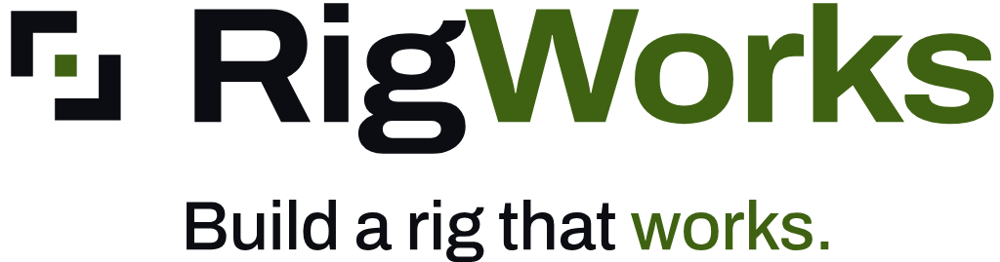

  <picture>
    <source media="(prefers-color-scheme: dark)" srcset="docs/brand/png/rigworks-lockup-tagline-dark-bg-1024w.png">
    
  </picture>

#

A modern, interactive PC configurator designed to make building custom computers simple, intuitive, and visually engaging.

## Features (Planned)

- PC component selection and compatibility checking
- Budget tracking and build cost estimation
- Saving, comparing, and sharing custom builds
- Modern, responsive interface with smooth animations

## Project Status

🚧 **In development**

The initial application foundation is implemented: React + TypeScript + Vite,
ASP.NET Core Web API on .NET 10, EF Core + SQL Server, and Identity cookie/CSRF
configuration. The development preview connects to the real API; product features
are not implemented yet.

See [local setup and commands](docs/development.md),
[architecture](docs/architecture.md), and [development log](docs/development-log.md).

The shared engineering and design specifications live in `.claude/`.

## Brand assets

- `docs/brand/`: PNG exports of every logo variant and a preview image, for use in documents and presentations.
- `frontend/src/assets/brand/`: the SVG masters (`rigworks-*.svg`) the app imports. Text is already converted to outlines, so no font is needed.
- `frontend/public/`: favicons (`favicon.svg`, `favicon.ico`, `apple-touch-icon.png`).

See [`docs/brand/README.md`](docs/brand/README.md) for variants and usage rules. The symbol and display typeface are provisional per `.claude/DESIGN.md`.

---

Developed as a diploma project for **SoftUni Buditel (2026–2027)**.
